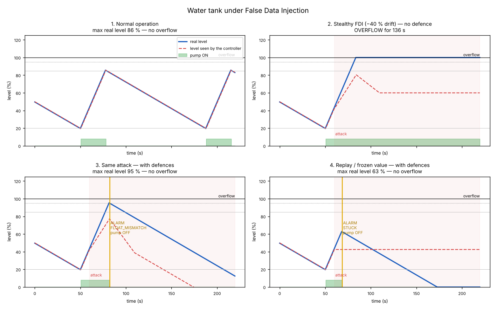
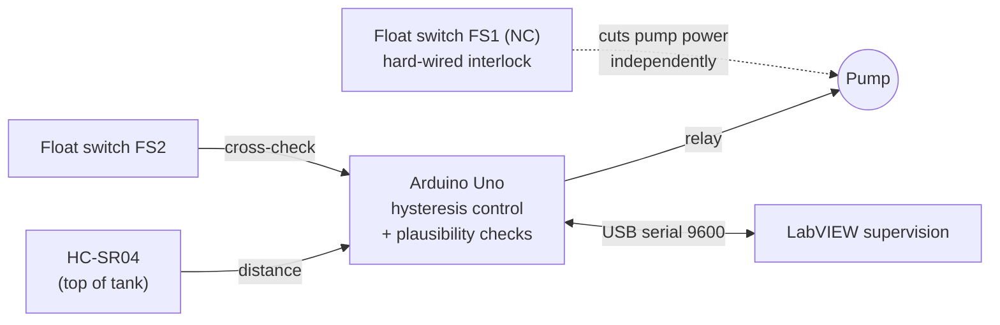

# Water Tank Monitoring & False Data Injection

Academic project (Embedded Systems & IoT, **IFRI — Université d'Abomey-Calavi**). It covers:

- automatic water-level control with an Arduino;
- LabVIEW supervision;
- a security study: what happens when an attacker **falsifies the sensor data** (*False Data Injection*, FDI), and how to make the system resilient with plausibility checks and an **independent high-level safety mechanism**.



## The system



- **Level:** an HC-SR04 measures the distance to the water surface, and the level in % is derived from the tank height.
- **Control:** hysteresis. The pump turns **ON below 20 %** and **OFF above 85 %**.
- **Supervision:** LabVIEW shows the level, pump, float switch and alarms, and can switch between auto and manual mode. See [docs/labview.md](docs/labview.md).

## The attack: False Data Injection

The controller trusts the level it receives. If an attacker can change that value (on the wire, in the firmware or in transit), they control the pump without touching it.

- **Naive attack:** a sudden jump of the reported value. It is easy to detect.
- **Stealthy attack (scenario 2):** the reported value follows the real level, minus a bias that grows **slowly** (0.4 %/s up to −40 %). The reading looks plausible, the controller never sees 85 %, the pump never stops, and the **tank overflows**.
- **Replay attack (scenario 4):** the attacker freezes the reading at its last genuine value.

## The defences

| # | Defence | Where | Catches |
| --- | --- | --- | --- |
| 1 | Range check (0–100 %) | firmware | absurd values |
| 2 | Rate check: the level cannot rise or fall faster than physically possible | firmware | sudden injections |
| 3 | Stuck-value check: pump ON but level unchanged for 8 s | firmware | replay / frozen value (scenario 4) |
| 4 | Cross-check with a float switch: switch says *full* while the sensor says < 80 % | firmware | stealthy bias (scenario 3) |
| 5 | **Hard-wired interlock**: float switch FS1 (NC) in series with the pump supply | hardware | **everything**, even a compromised Arduino |

On any detection, the pump is stopped (safe state), the buzzer and LED turn on, and an alarm code goes to LabVIEW. The pump stays off until the operator sends `RESET`. Defence 5 is the key idea of the study: **a safety function must not depend on the data it protects against.**

### Simulation results (`sim/fdi_simulation.py`)

| Scenario | Defences | Result |
| --- | --- | --- |
| 1. Normal operation | yes | level cycles between 20 % and 86 % |
| 2. Stealthy −40 % bias | **no** | **overflow for 136 s** |
| 3. Stealthy −40 % bias | yes | `FLOAT_MISMATCH` at t = 82 s, max 95 %, no overflow |
| 4. Replay / frozen value | yes | `STUCK` after 8.5 s of attack, no overflow |

In scenario 4, the pump then stays off and the tank drains. This is the expected *fail-safe* behaviour: an empty tank with an alarm is better than an overflow.

```bash
pip install matplotlib
python sim/fdi_simulation.py
```

## Hardware & wiring

| Component | Arduino Uno |
| --- | --- |
| HC-SR04 TRIG / ECHO | D9 / D10 |
| Relay module IN (pump) | D7 |
| Float switch FS2 (to GND, internal pull-up) | D2 |
| Buzzer | D8 |
| Alarm LED | D13 |

**Pump power circuit:** `+12 V → relay NO contact → FS1 (NC float switch) → pump → GND`.

FS1 and FS2 are mounted at the same height (95 %); a single float switch with two contacts also works. When the water reaches FS1, the circuit opens physically, whatever the Arduino commands.

## Lab demonstration of the attack

The firmware accepts demo commands, from the LabVIEW attack panel or any serial monitor, to reproduce the attacks on the real prototype:

| Command | Effect |
| --- | --- |
| `INJECT=-40` | adds a −40 % bias to the reading |
| `STUCK=45` | freezes the reported level at 45 % (`STUCK=-1` stops) |
| `RESET` | clears the alarm and the attack |
| `AUTO` / `MAN` / `PUMP=1` / `PUMP=0` | normal operation |

On the prototype, `INJECT` applies the bias at once, so the **rate check** catches it immediately. The slow, stealthy variant is the one studied in the simulation.

Serial frame sent every 500 ms: `L=46.3;D=17.5;P=0;F=0;M=A;A=NONE`

## Structure

```
firmware/water_tank/water_tank.ino   Arduino sketch (control, detection, protocol)
sim/fdi_simulation.py                attack / defence scenarios -> docs/fdi_scenarios.png
docs/labview.md                      LabVIEW VI: front panel and block diagram
```

---
**Author:** Maël Alain Bradley AZAÏNON — Embedded Systems & IoT, IFRI
